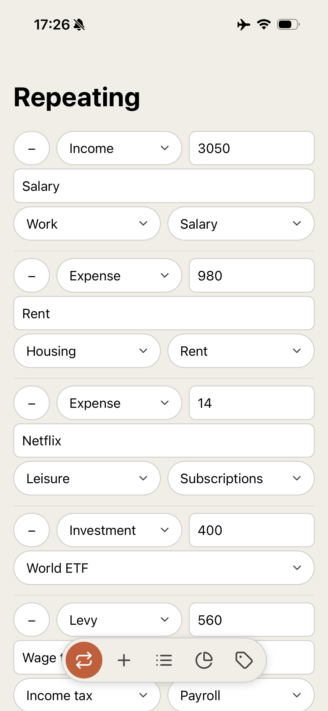
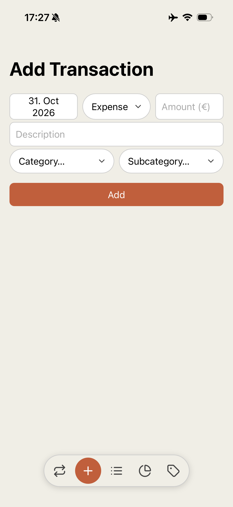
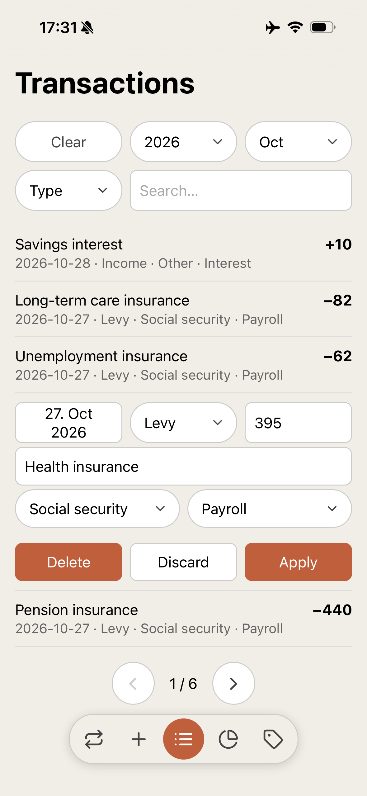
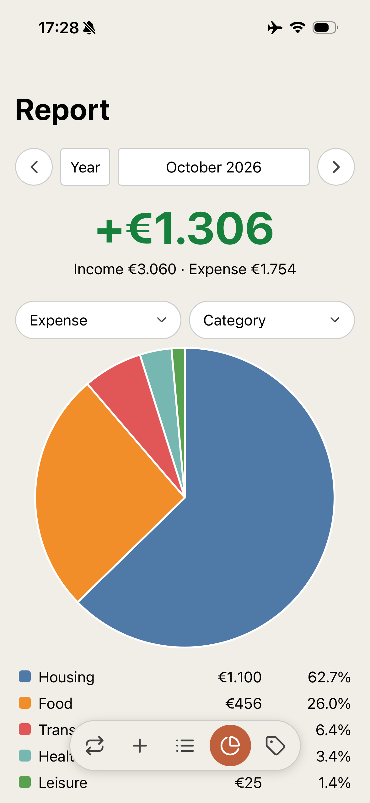
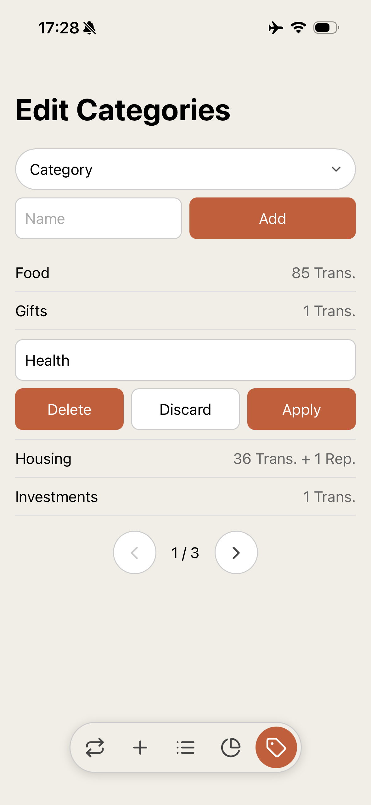

# Cashflow

Personal finance manager. Purposefully simple. Built for one person paid in euros.

This is a personal tool: issues are welcome, but pull requests may not be accepted.

| Repeating | Add | Transactions | Report | Categories |
| --- | --- | --- | --- | --- |
|  |  |  |  |  |

## Features

- Track your income, expense, levy, rebate, investment, and divestment
	- Income: The net that actually hit your bank account. Income = Earnings - Levy
	- Expense: Anything you paid.
	- Levy: Taxes and social duty payments deducted from your earnings.
	- Rebate: Levy you got back (e.g. refunded taxes).
	- Investment: How much you invested where.
	- Divestment: How much you withdrew from an investment
- Add, edit, or remove existing transactions or categories
- Save repeating monthly transactions and add with one click
- Generate monthly or yearly reports

## Example: Divestments

Given 100€ investment:

- sold with gain of 20€ -> 100€ divestment, 15€ income, 15€ levy
- sold with loss of 20€ -> 100€ divestment, 20€ expense

## Run

```zsh
go build -o cashflow ./cmd/cashflow
./cashflow -db test.db
```

It serves on http://127.0.0.1:47613.

The SQLite database is created and migrated on startup.

Demo data ready for screenshots: every page, at phone width, shows one plausible person paid in euros in Germany. It fills whole months ending with the current one (12 by default, `-months` changes it), with every Type, a saved Repeating list and some seasonal one-offs. It refuses a database that already has transactions:

```zsh
go run ./cmd/seed -db test.db
```

## Deployment

**Never expose the app publicly**; it has no login. It listens on `127.0.0.1` only; how you reach it is up to you, but never make it reachable from the internet (e.g. `tailscale funnel`, or a port forward on your router): limit access to your own devices.

The app runs as your own user from your clone; if you want isolation, set up a dedicated service user yourself. Replace `/path/to/cashflow` below and in `deploy/cashflow.service` with the path of your clone.

1. **Install Go** 1.26.5 or newer (the version in `go.mod`).

2. **Build** in the clone:

       cd /path/to/cashflow
       go build -o cashflow ./cmd/cashflow

3. **Install the user unit**:

       mkdir -p ~/.config/systemd/user
       cp /path/to/cashflow/deploy/cashflow.service ~/.config/systemd/user/

4. **Start the app** and enable it at boot. systemd restarts it on failure:

       systemctl --user daemon-reload
       systemctl --user enable --now cashflow
       sudo loginctl enable-linger "$USER"
       systemctl --user status cashflow

   The database is `/path/to/cashflow/finances.db`; it is created and migrated on first start.

Logs: `journalctl --user -u cashflow`.

**Changing the unit** (e.g. a wrong path): edit it in place, then restart. `cat` shows what systemd actually runs:

    systemctl --user edit --full cashflow
    systemctl --user restart cashflow
    systemctl --user cat cashflow

**Updating**:

    cd /path/to/cashflow
    git pull
    go build -o cashflow ./cmd/cashflow
    systemctl --user restart cashflow

## Backups

All data lives in the single database file, so back it up. Copying it while the app writes can catch it half-written; take a consistent copy first and move that copy off the machine:

    sqlite3 /path/to/cashflow/finances.db ".backup /tmp/finances_copy.db"

Or stop the app (`systemctl --user stop cashflow`) for the moment of the copy and start it again.

An automated nightly backup with integrity check and alerting is in [`deploy/BACKUP.md`](deploy/BACKUP.md). It is untested.

## Known limitations

- Search only ignores case for ASCII letters: "a" matches "A", but "ä" does not match "Ä".

## Licence

MIT, see [`LICENSE`](LICENSE). The vendored agent skills in `.agents/skills` come from [mattpocock/skills](https://github.com/mattpocock/skills) under their own MIT licence, see [`.agents/skills/LICENSE`](.agents/skills/LICENSE).
